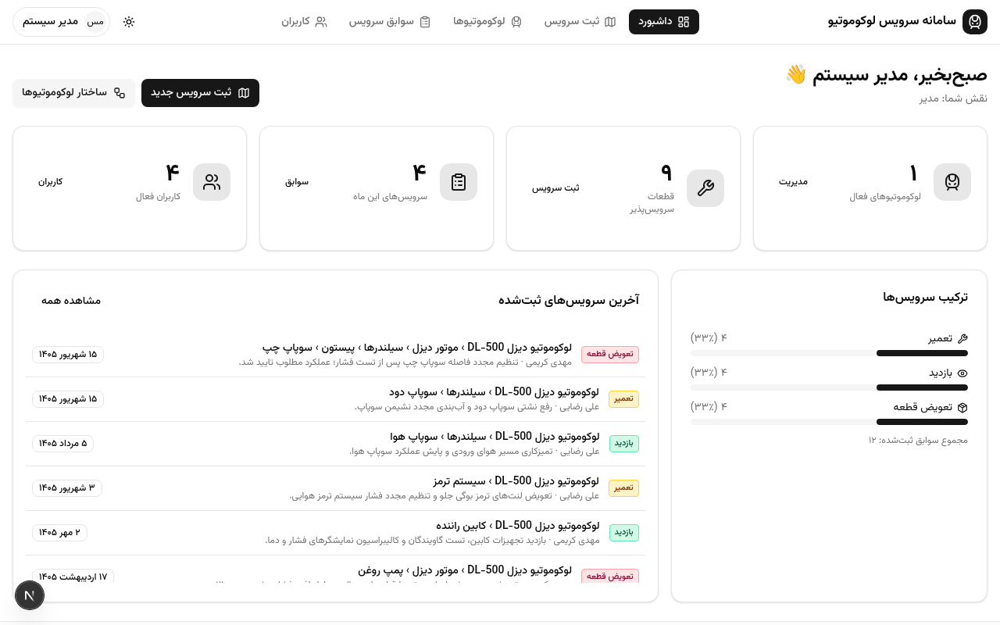

# سامانه ناوبری سرویس لوکوموتیو

**Locomotive Service Navigator** — اپلیکیشن وب ناوبری سلسله‌مراتبی تصویری برای تعمیرگاه‌های دیزل‌لوکوموتیو: از نمای کلی لوکوموتیو تا تک‌تک قطعات، با ثبت سوابق سرویس، تطبیق شماره سریال هنگام تعویض قطعه و گزارش‌گیری چاپی/اکسل.



## معرفی

در این سامانه، اپراتورها نقشه‌های فنی لوکوموتیو را بارگذاری کرده و روی آن‌ها نواحی تعاملی (Hotspot) مستطیلی تعریف می‌کنند که هر ناحیه به زیرنقشهٔ سطح بعدی متصل می‌شود. به این ترتیب سلسله‌مراتب عمیق قطعات (لوکوموتیو ← موتور دیزل ← سیلندر ← پیستون ← سوپاپ) به‌صورت کاملاً تصویری مدل می‌شود.

تعمیرکارها بدون نیاز به حفظ کد قطعه یا جستجوی متنی، با چند کلیک از لوکوموتیو تا قطعهٔ مورد نظر پیش می‌روند و در انتهای مسیر، فرم سرویس را ثبت می‌کنند: نوع سرویس (سرویس / بازدید / تعویض قطعه)، تاریخ جلالی، شماره قطعه، ساعت کار و توضیحات. هنگام تعویض قطعه، ثبت شماره سریال قطعهٔ جدید الزامی است و سامانه آن را با آخرین سریال ثبت‌شده (با توجه به تاریخ سرویس) تطبیق می‌دهد؛ در صورت مغایرت، گزینهٔ «عدم انطباق کد سریال» به‌صورت خودکار فعال می‌شود و موارد عدم انطباق در سوابق، داشبورد، گزارش چاپی و خروجی اکسل برجسته می‌گردند.

## امکانات کلیدی

- **ناوبری تصویری n-سطحی** — نقشه‌های فنی با نواحی مستطیلی قابل رسم (درگ ماوس/لمس) و اتصال به زیرنقشه‌ها
- **فرم سرویس کامل** — نوع سرویس، تاریخ جلالی (انتخابگر سه‌بخشی سال/ماه/روز)، شماره قطعه، ساعت کار، توضیحات + نمایش مسیر سلسله‌مراتب
- **تطبیق شماره سریال** — الزامی‌بودن سریال قطعهٔ جدید هنگام تعویض، نمایش سریال قبلی برای مقایسه، تشخیص عدم انطباق با محاسبهٔ سمت سرور (نسبت به تاریخ)
- **سوابق و فیلترها** — فیلتر لوکوموتیو، بازهٔ تاریخ جلالی، نوع سرویس و وضعیت تطبیق سریال (عدم انطباق / مطابق)
- **داشبورد مدیریتی** — شمارش سرویس‌ها، هشدار عدم انطباق سریال، فعالیت‌های اخیر
- **گزارش چاپی** — گزارش رسمی هر لوکوموتیو با خلاصهٔ آماری، ستون تطبیق و کادر هشدار؛ خروجی PDF از طریق چاپ مرورگر
- **خروجی اکسل** — دانلود سوابق فیلترشده در قالب XLSX راست‌به‌چپ با تاریخ جلالی، رنگ‌بندی موارد عدم انطباق و ردیف جمع
- **مدیریت کاربران و نقش‌ها** — مدیر / اپراتور / تعمیرکار با دسترسی متفاوت (احراز هویت scrypt + کوکی امضاشده HMAC)
- **رابط فارسی راست‌به‌چپ** — فونت وزیرمتن، تم روشن/تاریک، طراحی واکنش‌گرا از موبایل تا دسکتاپ

## نقش‌های کاربری

| نقش | دسترسی |
|---|---|
| مدیر | همهٔ بخش‌ها + مدیریت کاربران |
| اپراتور | مدیریت لوکوموتیوها، نقشه‌ها و سلسله‌مراتب + مشاهدهٔ سوابق |
| تعمیرکار | ناوبری قطعات، ثبت فرم سرویس و مشاهدهٔ سوابق |

## حساب‌های دمو

| نام کاربری | رمز عبور | نقش |
|---|---|---|
| `admin` | `admin123` | مدیر |
| `operator1` | `op123456` | اپراتور |
| `repairman1` | `rp123456` | تعمیرکار |
| `repairman2` | `rp123456` | تعمیرکار |

## فناوری‌ها

Next.js 16 (App Router) · React 19 · TypeScript · Tailwind CSS 4 · shadcn/ui · Prisma + **PostgreSQL** · ExcelJS · تاریخ جلالی با الگوریتم jalaali (اعتبارسنجی‌شده در برابر `Intl` fa-IR)

## راه‌اندازی سریع (محلی)

پیش‌نیاز: [Bun](https://bun.sh) و یک PostgreSQL در دسترس (محلی یا ابری مثل [Neon](https://neon.tech))

```bash
bun install            # نصب وابستگی‌ها (Prisma Client هم تولید می‌شود)
cp .env.example .env   # DATABASE_URL را به Postgres خود اشاره دهید
bun run db:push        # ساخت جداول
bun scripts/seed.ts    # درج دادهٔ دمو (قابل اجرای مکرر)
bun run dev            # اجرا روی http://localhost:3000
```

دادهٔ دمو: لوکوموتیو DL-500 با ۶ نقشه و ۱۸ ناحیهٔ تعاملی — سلسله‌مراتب ۴ سطحی موتور (نمای کلی ← موتور دیزل ← سیلندرها ← پیستون ← سوپاپ‌ها/رینگ) به‌همراه زیرقطعات سیستم ترمز (کمپرسور هوا، مخزن هوای فشرده، سیلندر و کفشک ترمز) و کابین راننده (شیشه جلو، تابلو دستگاه‌ها، اهرم فرمان) — و ۱۷ سابقهٔ نمونه شامل یک مورد عدم انطباق سریال.

## استقرار روی Vercel

> **چرا خطای اتصال به دیتابیس می‌گیرید؟** این پروژه قبلاً از SQLite (فایل محلی) استفاده می‌کرد. در ورسل توابع سرورلس فایل‌سیستم موقت و فقط-خواندنی دارند؛ دیتابیس فایلی آنجا کار نمی‌کند. پروژه اکنون روی **Neon Postgres** است و تصاویر آپلودی در **Neon Object Storage** (باکت S3-سازگار `assets`) ذخیره می‌شوند.

### گام ۱ — پروژهٔ Neon (از قبل آماده است)

پروژهٔ Neon شما: `rapid-math-15591303` (org `org-rough-cloud-79631716`، برنچ `production`، منطقهٔ `eu-central-1`) شامل Postgres و باکت `assets` است. مدیریت زیرساخت با فایل `neon.ts` انجام می‌شود:

```bash
neon deploy          # اعمال neon.ts (بافت‌ها) + کشیدن envها به .env
neon config status   # وضعیت زندهٔ برنچ
```

جداول و دادهٔ دمو از قبل روی برنچ production ساخته شده‌اند (`prisma db push` + `scripts/seed.ts` اجرا شده است).

### گام ۲ — متغیرهای محیطی در ورسل

در **Settings → Environment Variables** پروژهٔ ورسل این متغیرها را اضافه کنید (مقادیر از فایل `.env` محلی یا خروجی `neon env pull`):

| متغیر | مقدار |
|---|---|
| `DATABASE_URL` | رشتهٔ اتصال **Pooled** (با `-pooler`) + `sslmode=require` |
| `DATABASE_URL_UNPOOLED` | رشتهٔ اتصال **Direct** (بدون `-pooler`) — برای directUrl پرایسما |
| `AWS_ENDPOINT_URL_S3` / `AWS_ACCESS_KEY_ID` / `AWS_SECRET_ACCESS_KEY` / `AWS_REGION` | اعتبارنامه‌های Object Storage (باکت assets) |
| `AUTH_SECRET` | یک رشتهٔ تصادفی بلند (مثلاً ۶۴ کاراکتر هگز) |

### گام ۳ — استقرار

مخزن را به ورسل وصل کنید (Import Git Repository) و Deploy بزنید. Build به‌صورت خودکار `prisma generate` را اجرا می‌کند (postinstall).

**نکته‌های مهم:**

- **ذخیرهٔ تصاویر دوحالته است:** اگر باکت در دسترس باشد تصویر در باکت `assets` ذخیره می‌شود (کلید شیء در جدول `Upload`)، وگرنه بایت‌های تصویر در خود Postgres (ستون `Upload.bytes`) — در هر دو حالت تصویر از مسیر `/api/uploads/[id]` سرو می‌شود و هیچ داده‌ای از دست نمی‌رود.
- برای ساخت اعتبارنامهٔ جدید Object Storage: `neon credentials create --scope storage:read --scope storage:write --name <name>`
- تصاویر دموی seed به‌صورت فایل استاتیک داخل مخزن (`public/uploads/`) قرار دارند و نیازی به کار اضافه ندارند.
- اگر seed را دوباره اجرا کنید، در صورت وجود لوکوموتیو دموی هم‌نام skip می‌شود (با `--force` بازسازی کامل).

## ساختار پروژه

```
prisma/schema.prisma   # مدل داده: User, Train, PartNode, Area, ServiceRecord, Upload
neon.ts                # زیرساخت به‌مثابه کد: باکت Object Storage + سیاست برنچ‌ها
src/lib/               # احراز هویت، تاریخ جلالی، کلاینت API، helper ذخیره‌سازی S3
src/app/api/           # مسیرهای REST (auth, trains, nodes, areas, records, export, upload, uploads, users, stats)
src/components/app/    # کامپوننت‌های سامانه (ناوگر، سازندهٔ نقشه، فرم سرویس، سوابق، گزارش، کاربران)
src/components/ui/     # کامپوننت‌های پایه (shadcn/ui)
assets/demo/           # نقشه‌های فنی دمو
public/uploads/        # تصاویر استاتیک دمو (seed)
scripts/               # seed و ابزارهای کمکی
```

## نکتهٔ امنیتی

متغیر `AUTH_SECRET` (کلید امضای کوکی‌های نشست) در محیط عملیاتی باید در فایل `.env` با یک مقدار تصادفی بلند تنظیم شود؛ در نبود آن از مقدار پیش‌فرض توسعه استفاده می‌شود که فقط برای محیط آزمایشی مناسب است.
